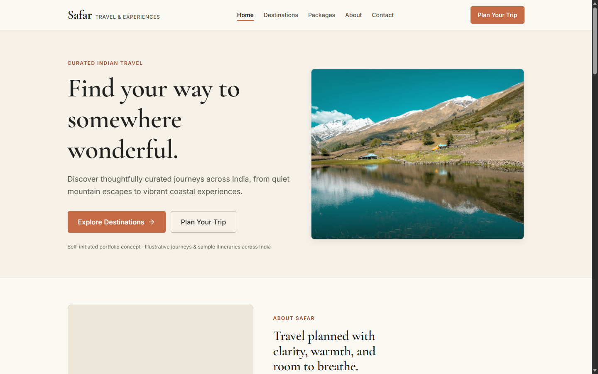
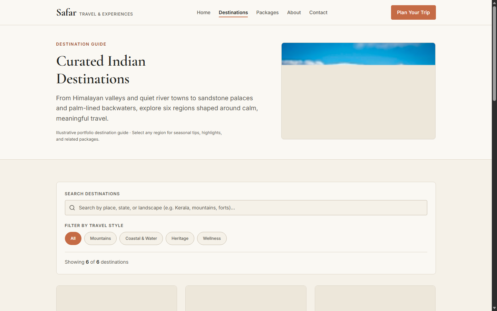
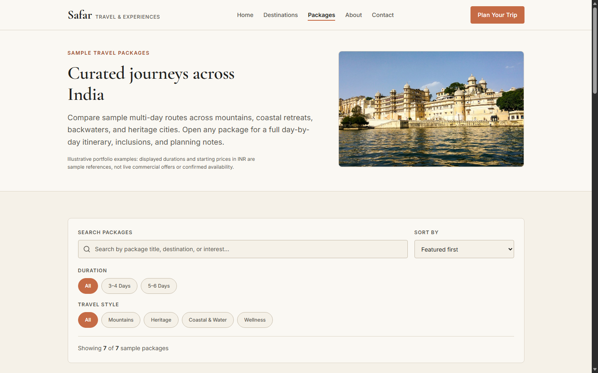
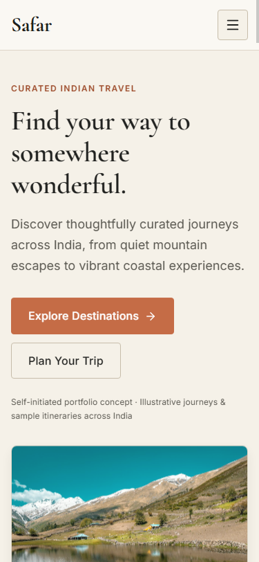

# Safar — Travel & Experiences

[](https://react.dev/)
[](https://vite.dev/)
[](https://reactrouter.com/)
[](https://safar-travel-experiences.vercel.app/)
[](https://github.com/Rahul1062005/safar-travel-experiences)

> **Live Demo:** [https://safar-travel-experiences.vercel.app/](https://safar-travel-experiences.vercel.app/)  
> **Repository:** [https://github.com/Rahul1062005/safar-travel-experiences](https://github.com/Rahul1062005/safar-travel-experiences)

A fictional Indian travel agency and experiences website concept built as a frontend portfolio project. Safar embodies an unhurried, editorial design direction—warm ivory backgrounds (`#F5F1E8`), charcoal typography (`#20211F`), muted terracotta accents (`#C56B45`), Cormorant Garamond headings, and Inter body text—paired with responsive architecture, interactive client-side discovery, and accessible form flows.

---

## Preview



---

## Project Overview

Safar was designed to explore how travel planning across India could feel calm, legible, and trustworthy. Rather than overwhelming travellers with cluttered feeds, opaque packages, or forced urgency banners, Safar presents:

- **Curated Regional Curation:** Six diverse regions across India (*Manali*, *Kashmir*, *Goa*, *Rajasthan*, *Kerala*, *Rishikesh*) covering mountain valleys, coastal towns, river retreats, and desert heritage.
- **Transparent Sample Itineraries:** Seven illustrative multi-day routes with day-by-day itineraries, highlights, indicative INR starting figures, and inclusions/exclusions.
- **Interactive Trip Enquiry Flow:** A client-side enquiry preview with automatic package or destination preselection, URL query parameters, instant validation, and local readback confirmation.

> **Portfolio Concept Notice:** Safar is a fictional concept brand built for demonstration purposes. All destinations, packages, sample prices, contact information (`hello@safar-demo.example`), and enquiry submissions run purely client-side. No live bookings, payments, or backend database storage are provided.

---

## Key Features

- **Editorial Homepage (`/`):** Full visual introduction with hero photography, brand philosophy, six regional destination previews, featured sample packages showcase, core travel principles, and closing call to action.
- **Destination Discovery & Dedicated Guides (`/destinations`, `/destinations/:slug`):**
  - Search by region, state, or landscape keyword.
  - Travel-style filter pills (*Mountains & Valleys*, *Coastal & Beach*, *Heritage & Culture*, *Spiritual & Wellness*).
  - Dedicated guide page for each destination featuring seasonal timing advice, top attractions, suggested stay durations, and related tour packages.
- **Sample Tour Packages Directory (`/packages`, `/packages/:slug`):**
  - Search by package title, region, or interest.
  - Duration bucket filters (*Short Stays 3–4 Days*, *Classic Journeys 5–6 Days*) and style filters.
  - Sorting by featured first, indicative price (low-to-high / high-to-low), and shortest duration.
  - One-click filter reset and contextual empty recovery states.
  - Detailed package itinerary pages with day-by-day timelines, highlights, and inclusions/exclusions checklists.
- **About Page & Travel Philosophy (`/about`):** Editorial narrative detailing the fictional brand concept, four travel philosophy pillars, four service principles, and closing exploration links.
- **Interactive Enquiry Flow (`/contact`):**
  - Controlled React form validating full name (minimum 2 characters), email format, optional phone digits (7–15 characters), and optional group size (1–30 travellers).
  - Inline accessible error announcements (`role="alert"`, `aria-invalid="true"`, `aria-describedby`).
  - URL query preselection (`/contact?package=<slug>` and `/contact?destination=<slug>`) with banner context and safe fallback to *General Travel Enquiry* on unrecognized queries.
  - Local demo confirmation card (`role="status"`) with data readback and one-click reset.
  - Optional `mailto:` handoff link pre-populating enquiry parameters into the user's default email client.
- **Responsive Navigation & Accessibility:**
  - Responsive header with active route indicators and a smooth mobile navigation drawer.
  - Semi-transparent backdrop with background scroll-lock (`overflow: hidden`), Escape key listener, and click-outside dismissal.
  - Semantic HTML landmarks, skip-to-main-content link, WCAG-compliant touch targets (`min-height: 40px–44px`), and `prefers-reduced-motion` support.

---

## Visual Screenshots Gallery

### Homepage Desktop


### Destination Directory


### Packages Directory & Discovery Controls


### Mobile Experience (375px)


---

## Technology Stack

| Category | Technology | Purpose |
| :--- | :--- | :--- |
| **Framework** | [React 19](https://react.dev/) | Component architecture, state management, and declarative UI |
| **Routing** | [React Router 7](https://reactrouter.com/) | Client-side routing, dynamic route parameters, and URL search parameters |
| **Tooling & Bundler** | [Vite 8](https://vite.dev/) | Development server with instant HMR and optimized production bundling |
| **Styling** | Plain Modular CSS | Design tokens ([tokens.css](src/styles/tokens.css)), CSS reset ([reset.css](src/styles/reset.css)), and scoped component styles |
| **Icons** | [Lucide React](https://lucide.dev/) | Lightweight, accessible SVG icon primitives |
| **Linter** | [Oxlint](https://oxc.rs/) | Fast JavaScript and JSX linting |
| **Deployment** | [Vercel](https://vercel.com/) | Global edge hosting with SPA rewrite rules ([vercel.json](vercel.json)) |

---

## Installation & Local Development

### Prerequisites

- **Node.js:** `20.19.0+` or `22.12.0+` (LTS recommended).  
  *Note: Vite 8 requires Node.js 20+; Node.js 18 and earlier versions are not supported.*
- **Package Manager:** `npm` (included with Node.js)

### Setup Commands

```bash
# 1. Clone the repository
git clone https://github.com/Rahul1062005/safar-travel-experiences.git

# 2. Navigate to the project directory
cd safar-travel-experiences

# 3. Install dependencies
npm install

# 4. Start the local development server
npm run dev

# 5. Run the linter
npm run lint

# 6. Build for production
npm run build

# 7. Preview the production build locally
npm run preview
```

The development server runs locally at `http://localhost:5173/` by default.

---

## Project Structure

```text
safar-travel-experiences/
├── docs/
│   └── screenshots/        # Live website screenshots for repository documentation
├── public/                 # Static assets (favicon.svg, robots.txt, sitemap.xml)
├── src/
│   ├── assets/images/      # Curated Indian travel photography (JPEG)
│   ├── components/         # Reusable UI primitives (Button, cards, Navbar, Footer, EmptyState)
│   ├── data/               # Structured data modules (destinations.js, packages.js, siteContent.js)
│   ├── layouts/            # Shared layout shell (MainLayout.jsx with Navbar, Outlet, Footer)
│   ├── pages/              # Route views (Home, Destinations, Packages, Details, About, Contact, 404)
│   ├── routes/             # AppRoutes.jsx centralized React Router map
│   ├── styles/             # Design tokens, reset, typography, and page stylesheets
│   └── utils/              # Enquiry preselection/validation helpers and useDocumentMeta hook
├── .gitignore              # Excludes node_modules, build artifacts, and env files
├── .oxlintrc.json          # Oxlint configuration
├── index.html              # Base HTML shell with theme-color and Open Graph meta tags
├── package.json            # Project dependencies, scripts, and engine configurations
├── vercel.json             # Vercel SPA rewrite configuration for React Router
└── vite.config.js          # Vite configuration with React plugin
```

---

## Application Routes

| Path | Component | Description |
| :--- | :--- | :--- |
| `/` | `HomePage` | Editorial hero, brand story, featured destinations, sample packages, and values |
| `/destinations` | `DestinationsPage` | Searchable and filterable directory of six curated Indian destinations |
| `/destinations/:slug` | `DestinationDetailPage` | Dynamic guide for individual destinations with attractions, best seasons, and packages |
| `/packages` | `PackagesPage` | Searchable, filterable, and sortable directory of seven sample tour packages |
| `/packages/:slug` | `PackageDetailPage` | Dynamic itinerary page with day-by-day schedule, starting price, and inclusions |
| `/about` | `AboutPage` | Editorial story, travel philosophy pillars, service principles, and CTAs |
| `/contact` | `ContactPage` | Trip enquiry form with validation, URL preselection, demo summary, and fallback |
| `*` | `NotFoundPage` | Editorial 404 recovery page with quick navigation back to home or destinations |

---

## Deployment Configuration

Safar is deployed to production on [Vercel](https://safar-travel-experiences.vercel.app/).

Because the website uses client-side routing via React Router's `BrowserRouter`, direct requests to deep paths (such as `/packages/himalayan-escape` or `/destinations/kerala`) must route to `index.html`. This is handled by [vercel.json](vercel.json):

```json
{
  "rewrites": [
    {
      "source": "/(.*)",
      "destination": "/index.html"
    }
  ]
}
```

Static assets (images, stylesheets, scripts, favicon, robots.txt, sitemap.xml) in the `dist` directory are served directly by Vercel's edge network, while client-side routes route cleanly into the React application.

---

## Disclaimer

Safar is a **fictional portfolio concept** designed solely for frontend development and UI/UX portfolio demonstration.

- **Illustrative Pricing & Itineraries:** Prices in INR, durations, and day-by-day plans are illustrative samples and do not represent actual travel bookings, real-time availability, or commercial offerings.
- **Frontend-Only Enquiry:** The enquiry form validates and previews submissions entirely in the browser using React state. No personal data is sent to a server, saved in a database, or shared.
- **Demo Contact Information:** The provided email (`hello@safar-demo.example`) and address are fictional placeholders.
